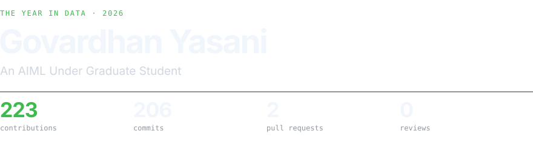
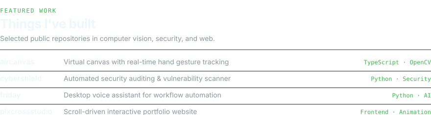
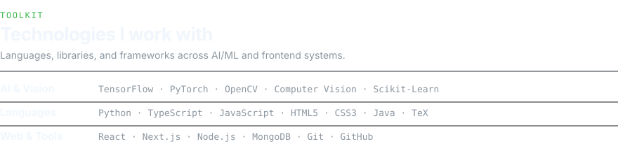

<picture>
  <source media="(prefers-color-scheme: light)" srcset="https://raw.githubusercontent.com/govardhanprabhavathi/govardhanprabhavathi/main/assets/story-mast-light.svg" />
  
</picture>

  <a href="https://github.com/govardhanprabhavathi">GitHub</a> · 
  <a href="https://govardhanyasani.vercel.app">Website</a> · 
  <a href="https://www.linkedin.com/in/govardhan-yasani">LinkedIn</a> · 
  <a href="https://x.com/GovardhanGoru">X</a>

<picture>
  <source media="(prefers-color-scheme: light)" srcset="https://raw.githubusercontent.com/govardhanprabhavathi/govardhanprabhavathi/main/assets/story-projects-light.svg" />
  
</picture>

  <a href="https://github.com/govardhanprabhavathi/aircanvas">aircanvas</a> · 
  <a href="https://github.com/govardhanprabhavathi/cybershield">cybershield</a> · 
  <a href="https://github.com/govardhanprabhavathi/friday">friday</a> · 
  <a href="https://github.com/govardhanprabhavathi/pixcrossstudio">pixcrossstudio</a>

<picture>
  <source media="(prefers-color-scheme: light)" srcset="https://raw.githubusercontent.com/govardhanprabhavathi/govardhanprabhavathi/main/assets/story-stack-light.svg" />
  
</picture>

<picture>
  <source media="(prefers-color-scheme: light)" srcset="https://raw.githubusercontent.com/govardhanprabhavathi/govardhanprabhavathi/main/assets/story-life-light.svg" />
  
</picture>

<picture>
  <source media="(prefers-color-scheme: light)" srcset="https://raw.githubusercontent.com/govardhanprabhavathi/govardhanprabhavathi/main/assets/story-timeline-light.svg" />
  
</picture>

<picture>
  <source media="(prefers-color-scheme: light)" srcset="https://raw.githubusercontent.com/govardhanprabhavathi/govardhanprabhavathi/main/assets/story-rhythm-light.svg" />
  
</picture>

<picture>
  <source media="(prefers-color-scheme: light)" srcset="https://raw.githubusercontent.com/govardhanprabhavathi/govardhanprabhavathi/main/assets/story-bubbles-light.svg" />
  
</picture>

<picture>
  <source media="(prefers-color-scheme: light)" srcset="https://raw.githubusercontent.com/govardhanprabhavathi/govardhanprabhavathi/main/assets/story-radar-light.svg" />
  
</picture>

Data Story · charts from my public GitHub activity
